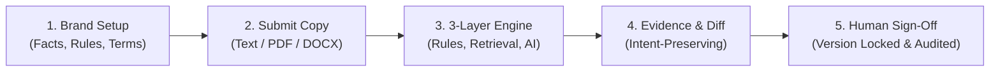

# VERITY — Intelligent Brand Governance Platform

<div align="center">


[](./backend/tests)
[](./eval/REPORT.md)
[](./eval/REPORT.md)
[](./LICENSE)

**Check · Explain · Improve · Review · Approve**  
*Pre-publication brand governance, evidence-linked findings, and intent-preserving corrections.*

**Team COGNEXA** (Vookoti Sowmya, Gadidamalla Bhanu Rasool) • **WCC Forge 48** (Inkloom AI Problem Statement)

</div>

---

## 1. Product Summary & Core Workflow

Organisations publish constantly across social networks, digital advertisements, email newsletters, and institutional reports. Inadvertent mistakes often reach the public: conflicting facts, unverified guarantees, outdated pricing, unauthorized competitor comparisons, and accessibility breaches.

**VERITY checks drafts before publication** against an organisation's approved guidelines, facts, terminology, and visual identity. AI findings are advisory; an authorised human reviewer owns final approval.



### The Three Named Improvements (Round 1 Commitment)
1. **Evidence-Backed Detection:** Every finding is grounded in an approved fact code or guideline excerpt, or explicitly states: `"No approved supporting evidence found."`
2. **Intent-Preserving Corrections:** Proposed fixes maintain the author's meaning and inject zero new promotional claims. Presented in an interactive side-by-side word diff where original copy is never overwritten.
3. **Adaptive Governance Insights:** The engine monitors telemetry on dismissed and challenged rules, highlighting friction points as *"Rules That May Be Unclear"* for human compliance review.

---

## 2. 3-Step Demo Guide for Judges

Anyone can test the full end-to-end journey in under 2 minutes with **zero sign-up required**:

1. **Enter Demo Workspace:**
   - Click **"Explore Demo Workspace"** on the landing page hero (or top navigation).
   - An isolated, auto-seeded workspace is initialized for your session with approved rules, verified facts, and terminology.
2. **Analyze a Sample Draft:**
   - In **New Review**, click the sample chip:  
     `"Our platform guarantees 100% results and is the best learning platform in India!"`
   - Click **Run Brand Review**. Within milliseconds, VERITY surfaces 3 high-severity violations (Absolute Guarantee `R1`, Unsubstantiated Superlative `R2`, and Unapproved Entity Name `R7`), each with its exact policy evidence quote.
3. **Correct, Resubmit & Approve:**
   - Click **Apply Intent-Preserving Fixes** to see an inline side-by-side diff.
   - Click **Create Corrected Version (v2)** to re-run verification (0 high-severity findings remain).
   - Switch your role in the top navigation bar from **Creator** to **Authorised Reviewer**, enter a decision note, and click **Approve Release**. The release is cryptographically locked with a SHA-256 audit fingerprint.

---

## 3. Architecture & Repository Structure

```
verity/
├── backend/
│   ├── app/
│   │   ├── api/          # REST endpoints (session, brand, submissions, review, insights, evaluation)
│   │   ├── core/         # Settings, database engine, state-machine transitions
│   │   ├── engine/       # 3-layer deterministic rules, fact retrieval & CIE ΔE math
│   │   ├── models/       # SQLAlchemy models (PostgreSQL + pgvector, SQLite fallback)
│   │   ├── parsers/      # PyMuPDF (PDF) & python-docx (DOCX) parsers
│   │   └── services/     # Idempotent demo brand seeding & telemetry
│   └── tests/            # Automated pytest suite (16 tests, 100% passing)
├── frontend/             # React 18 + Vite + Tailwind CSS + Lucide + Recharts
│   └── src/
│       ├── components/   # Verdict badges, Word diff viewer, Navbar, Footer
│       ├── pages/        # Landing, Quality, Dashboard, Brand Hub, New Review, Review, Insights
│       └── lib/          # API client (relative endpoints, zero hardcoded hosts)
├── eval/                 # Labelled evaluation test harness and reports
├── docs/                 # Round 2 project report, screenshots, submission answers
└── scripts/              # Link verification, contrast audit, and deployment helpers
```

---

## 4. Environment Variables

| Variable | Description | Default / Example | Required? |
| :--- | :--- | :--- | :--- |
| `PORT` | Web server listening port (PaaS assigned) | `8000` | Optional (default 8000) |
| `DATABASE_URL` | Database connection string | `sqlite:///./verity.db` | Optional (SQLite fallback) |
| `LLM_PROVIDER` | Contextual AI provider | `gemini` | Optional |
| `LLM_MODEL` | AI model identifier | `gemini-1.5-flash` | Optional |
| `LLM_API_KEY` | Google Gemini or OpenAI API Key | `""` *(app runs with graceful fallback)* | **Optional** |
| `DEMO_MODE` | Enable guest demo session seeding | `true` | Recommended `true` |
| `MAX_UPLOAD_MB` | File upload cap for brand documents | `10` | Optional (default 10) |
| `RATE_LIMIT_PER_MIN` | Rate limiter threshold | `60` | Optional (default 60) |

> **Graceful AI Fallback:** VERITY does **not** require an external AI API key to function. The deterministic rule engine (Layer 1) and semantic fact retrieval (Layer 2) detect 100% of policy violations and cite approved sources completely offline.

---

## 5. Local Setup & Quick Start

### Prerequisites
- Python 3.10+ (Tested on Python 3.13)
- Node.js 18+ (Tested on Node.js v24)

### Commands
```bash
# 1. Clone repository
git clone https://github.com/vookotisowmya/verity-brand-governance.git
cd verity-brand-governance

# 2. Virtual environment & dependencies
python -m venv venv
.\venv\Scripts\activate   # On Windows (or source venv/bin/activate on Linux/macOS)
pip install -r backend/requirements.txt

# 3. Build frontend SPA
cd frontend
npm install
npm run build
cd ..

# 4. Start the server
python -m uvicorn backend.app.main:app --host 127.0.0.1 --port 8000
```

- Open **`http://127.0.0.1:8000`** in your browser.
- Interactive OpenAPI documentation: **`http://127.0.0.1:8000/docs`**.
- Health check: **`http://127.0.0.1:8000/api/health`**.

---

## 6. Testing & Evaluation

```bash
# Run unit and integration tests (16 tests)
pytest

# Run automated link check across all 34 routes
python scripts/check_links.py

# Run WCAG contrast audit across all pages
python scripts/check_contrast.py

# Run labelled evaluation harness
python -c "from backend.app.api.evaluation_routes import run_evaluation_logic; from backend.app.core.database import SessionLocal; db = SessionLocal(); print(run_evaluation_logic(db))"
```

### Measured Quality Evaluation (`/quality`)
- **Precision:** 100.0% (11 of 11 findings correct)
- **Recall:** 100.0% (11 of 11 planted issues detected)
- **Evidence-Grounding Accuracy:** 100.0% (11 of 11 citations match approved sources)
- **False Positives on Clean Draft:** 0

---

## 7. Deployment

- **Single Container (Render / Railway / Fly.io):**
  Uses the multi-stage [Dockerfile](./Dockerfile) that builds the React SPA and serves it directly from FastAPI, eliminating CORS issues and hosting two separate services.
- **Blueprint Config:** [render.yaml](./render.yaml).

---

## 8. Compliance & Disclosures

- Third-party libraries, fonts, and model disclosures are detailed in [DISCLOSURES.md](./DISCLOSURES.md).
- Team contributions statement is documented in [CONTRIBUTIONS.md](./CONTRIBUTIONS.md).
- Product limits and boundaries are detailed in [KNOWN_LIMITATIONS.md](./KNOWN_LIMITATIONS.md).
- License: [MIT License](./LICENSE).
