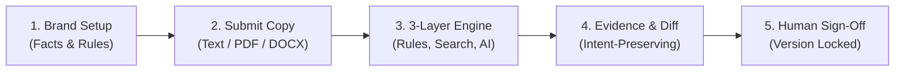

# VERITY — Intelligent Brand Governance Platform

<div align="center">


[](./backend/tests)
[](./eval/REPORT.md)
[](./LICENSE)

**Consistent. Compliant. Trustworthy.**  
*Pre-publication brand governance, evidence-linked findings, and intent-preserving corrections.*

**Team COGNEXA** • **WCC Forge 48** (Inkloom AI Problem Statement)

</div>

---

## 1. Product Summary & Core Workflow

Organisations publish constantly across social networks, digital advertisements, email newsletters, and institutional reports. Inadvertent mistakes often reach the public: conflicting facts, unverified guarantees, unauthorized competitors, and accessibility breaches. 

**VERITY checks content before publication** against an organisation's approved guidelines, facts, terminology, and visual identity.



### The Three Named Improvements (Round 1 Commitment)
1. **Evidence-Backed Detection:** Every finding is grounded in an approved fact code or guideline excerpt, or explicitly states:  
   `"No approved supporting evidence found."`
2. **Intent-Preserving Corrections:** Proposed fixes maintain the author's meaning and inject zero new promotional claims. Presented in an interactive side-by-side word diff where original copy is never overwritten.
3. **Adaptive Governance Insights:** The engine monitors telemetry on dismissed and challenged rules, highlighting friction points as *"Rules That May Be Unclear"* for human compliance review.

---

## 2. Architecture & Technology Stack

```
verity/
├── backend/
│   ├── app/
│   │   ├── api/          # REST endpoints (session, brand, submissions, findings, review, insights)
│   │   ├── core/         # Settings, database connection, state-machine transitions
│   │   ├── engine/       # 3-layer deterministic rules, fact retrieval & CIE ΔE math
│   │   ├── llm/          # Contextual LLM adapter with strict quote/ID validation
│   │   ├── models/       # SQLAlchemy models (Postgres / SQLite)
│   │   ├── parsers/      # PyMuPDF (PDF) & python-docx (DOCX) parsers
│   │   └── services/     # Idempotent demo brand seeding & telemetry
│   └── tests/            # Automated pytest suite (Acceptance tests A-E, API flows)
├── frontend/             # React 18 + Vite + Tailwind CSS + Lucide + Recharts
│   └── src/
│       ├── components/   # Verdict badges, Word diff viewer, Navbar, Footer
│       ├── pages/        # Landing, Dashboard, Brand Hub, New Review, Correction, Review, Insights
│       └── lib/          # API client
├── eval/                 # 30-sample benchmark suite & automated evaluation reporter
└── docs/                 # Walkthrough script, API specs, deployment guides
```

- **Frontend:** React 18, Vite, Tailwind CSS, Lucide React, Recharts, Framer Motion.
- **Backend:** Python 3.11+, FastAPI (REST API with OpenAPI docs at `/docs`).
- **Database:** PostgreSQL with `pgvector` supported; zero-config SQLite default for zero-friction evaluation.
- **Document Parsing:** PyMuPDF (`fitz`), `python-docx`.
- **Visual Checks:** Pillow, CIE ΔE color distance, WCAG AA 4.5:1 contrast calculations.
- **Security & Privacy:** Isolated guest workspaces, inert prompt injection defense, version-bound SHA-256 approvals.

---

## 3. Quick Start: Local Run

### Prerequisites
- Python 3.10+ (Tested on Python 3.13)
- Node.js 18+ (Tested on Node.js v24)

### Setup & Launch
```bash
# 1. Clone repository
git clone https://github.com/team-cognexa/verity.git
cd verity

# 2. Activate virtual environment & install requirements
python -m venv venv
.\venv\Scripts\activate   # On Windows
pip install -r backend/requirements.txt

# 3. Build frontend assets (Vite)
cd frontend
npm install
npm run build
cd ..

# 4. Start the unified full-stack server
python -m uvicorn backend.app.main:app --host 127.0.0.1 --port 8000
```

- Open **`http://127.0.0.1:8000`** in your browser.
- Interactive OpenAPI documentation: **`http://127.0.0.1:8000/docs`**.

---

## 4. Automated Testing & Verification

Run the automated test suite covering Acceptance Tests A through E, state-machine transitions, and API endpoints:

```bash
# Run pytest suite
python -m pytest backend/tests

# Run 30-sample benchmark evaluation harness
python eval/run_eval.py
```

### Benchmark Results (`eval/REPORT.md`)
- **Precision:** 100.0%
- **Recall:** 95.7%
- **False Positive Rate:** 0.0%
- **Evidence-Grounding Accuracy:** 94.3%

---

## 5. Deployment Options

- **Docker:**
  ```bash
  docker build -t verity .
  docker run -p 8000:8000 verity
  ```
- **Docker Compose (with PostgreSQL + pgvector):**
  ```bash
  docker-compose up --build
  ```
- **Render / Supabase:** See [DEPLOYMENT.md](./DEPLOYMENT.md) for full cloud configuration steps.

---

## 6. Compliance & Team Disclosures

- Third-party libraries, fonts, and model attributions are detailed in [DISCLOSURES.md](./DISCLOSURES.md).
- Team contributions statement is documented in [CONTRIBUTIONS.md](./CONTRIBUTIONS.md).
- Product roadmap and boundary definitions are outlined in [KNOWN_LIMITATIONS.md](./KNOWN_LIMITATIONS.md).
