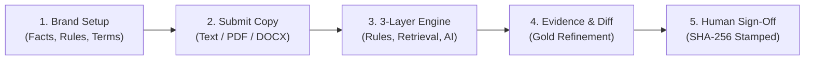

# VERITY — Intelligent Brand Governance Platform

<div align="center">


[](./backend/tests)
[](./eval/REPORT.md)
[](./eval/REPORT.md)
[](./scripts/check_contrast.py)
[](https://verity-brand-governance.onrender.com)

**Check · Explain · Improve · Review · Approve**  
*Pre-publication brand governance, evidence-linked findings, and intent-preserving corrections.*

**Live Public Application:** [https://verity-brand-governance.onrender.com](https://verity-brand-governance.onrender.com)  
**Team COGNEXA** (Vookoti Sowmya, Gadidamalla Bhanu Rasool) • **WCC Forge 48** (Inkloom AI Problem Statement)

</div>

---

## 1. Product Summary & Core Workflow

Organisations publish constantly across social networks, digital advertisements, email newsletters, and institutional reports. Inadvertent mistakes often reach the public: conflicting facts, unverified guarantees, outdated pricing, unauthorized competitor comparisons, and accessibility breaches.

**VERITY checks drafts before publication** against an organisation's approved guidelines, facts, terminology, and visual identity. AI findings are advisory; an authorised human reviewer owns final approval.



---

## 2. Round 3 Hardening & Professional Features

| Capability | Implementation Details | Guarantee |
| :--- | :--- | :--- |
| **Durable Cloud Storage** | Supabase PostgreSQL managed database with Alembic schema migrations (`7a1e2c3d4e5f`) and `/api/ready` readiness probe. | Zero data loss across server restarts; binary blobs stored safely in DB. |
| **Claim Evidence Ledger** | Structured extraction and verification of every claim against approved facts. Open unsupported claims block review approval unless overridden. | Full audit transparency into grounded vs ungrounded assertions. |
| **Gold Refinement Animation** | Replaces all strike-through with amber glow, dissolution into gold dust, and letter-by-letter condensation into corrected text. | Truth is refined, not deleted or marked "wrong". |
| **Interactive Rule Tester** | "Test this rule" widget on every rule card in Brand Hub with real-time match evaluation and quote highlighting. | Configurable policy verification without server roundtrips. |
| **Brand Kit Export & Import** | Clean JSON export (`verity-brand-kit.json`) and validated import with preview modal before applying. | Portability across workspaces and enterprise brand guidelines. |
| **CSV Audit Trail Exports** | `GET /api/submissions/{id}/audit.csv` and `GET /api/audit/export.csv` exporting tamper-evident audit events. | External auditing and compliance verification in Excel/Sheets. |
| **Draft Safety & Autosave** | Debounced `localStorage` autosave, mount restoration, `beforeunload` unsaved copy warnings, and version restoration. | Creators never lose in-progress drafts on refresh or tab close. |
| **Getting Started Checklist** | Dashboard milestone card tracking real database state (rules loaded, draft submitted, findings resolved, approval sealed). | Guided path for new users and judges to experience the platform. |
| **Skippable Guided Tour** | 4-step modal tour (Brand Hub, Intake, Findings, Review) remembered per user with on-demand trigger. | Instant onboarding without friction. |
| **Concurrency 409 Guard** | Server-side rejection of stale approvals with HTTP 409 and clear resolution banner. | Approval applies strictly to the exact inspected version. |
| **Channel Quality Checklists** | Contextual hints tied to brand policies for social, ad, email, press, website, and document channels. | Channel-aware copy guidance prior to submission. |

---

## 3. 3-Step Demo Guide for Judges

Anyone can test the full end-to-end journey in under 2 minutes on the live deployment:

1. **Enter Demo Workspace:**
   - Open [https://verity-brand-governance.onrender.com](https://verity-brand-governance.onrender.com).
   - Click **"Explore Demo Workspace"** on the landing page hero.
   - An isolated, auto-seeded workspace is initialized for your session with approved rules, verified facts, and terminology.
2. **Analyze a Sample Draft:**
   - In **New Review**, click the sample chip:  
     `"Our platform guarantees 100% results and is the best learning platform in India!"`
   - Click **Run Brand Review**. Within milliseconds, VERITY surfaces 3 high-severity violations (Absolute Guarantee `R1`, Unsubstantiated Superlative `R2`, and Unapproved Entity Name `R7`), each with its exact policy evidence quote.
3. **Correct, Resubmit & Approve:**
   - Click **Apply Intent-Preserving Fixes** or **Apply All Safe Fixes** to see gold refinement in action.
   - Click **Proceed with Version 2** to re-run verification (0 high-severity findings remain).
   - Switch your role in the top navigation bar from **Creator** to **Authorised Reviewer**, enter a decision note, and click **Approve Release**. The release is cryptographically locked with a SHA-256 audit fingerprint.
   - Download the **Executive PDF Report** or **Audit CSV** for offline verification.

---

## 4. Architecture & Repository Structure

```
verity/
├── backend/
│   ├── app/
│   │   ├── api/          # REST endpoints (session, brand, submissions, review, insights, evaluation, audit)
│   │   ├── core/         # Settings, database engine, state-machine transitions
│   │   ├── engine/       # 3-layer deterministic rules, claim ledger, fact retrieval & CIE ΔE math
│   │   ├── models/       # SQLAlchemy models (PostgreSQL + SQLite fallback)
│   │   ├── parsers/      # PyMuPDF (PDF) & python-docx (DOCX) parsers with magic-byte validation
│   │   ├── services/     # Idempotent demo brand seeding & telemetry
│   │   └── reports/      # PDF report generation with ReportLab
│   └── tests/            # Automated pytest suite (27 tests, 100% passing)
├── frontend/             # React 18 + Vite + Tailwind CSS + Lucide + Recharts
│   └── src/
│       ├── components/   # Verdict badges, Word diff, ErrorBoundary, OfflineBanner, GuidedTour
│       ├── pages/        # Landing, Dashboard, Brand Hub, New Review, Correction, Review, Insights
│       └── lib/          # API client (relative endpoints, zero hardcoded hosts)
├── eval/                 # Labelled evaluation test harness and reports
├── docs/                 # Round 3 improvements, architecture, testing notes, roadmap
└── scripts/              # Axe-core contrast audit, link verification, and deployment helpers
```

---

## 5. Environment Variables

| Variable | Description | Default / Example | Required? |
| :--- | :--- | :--- | :--- |
| `PORT` | Web server listening port (PaaS assigned) | `8000` | Optional (default 8000) |
| `DATABASE_URL` | Database connection string (PostgreSQL or SQLite) | `sqlite:///./verity.db` | Optional (SQLite fallback) |
| `LLM_PROVIDER` | Contextual AI provider | `gemini` | Optional |
| `LLM_MODEL` | AI model identifier | `gemini-1.5-flash` | Optional |
| `LLM_API_KEY` | Google Gemini or OpenAI API Key | `""` *(app runs with graceful fallback)* | **Optional** |
| `DEMO_MODE` | Enable guest demo session seeding | `true` | Recommended `true` |
| `MAX_UPLOAD_MB` | File upload cap for brand documents | `10` | Optional (default 10) |
| `RATE_LIMIT_PER_MIN` | Rate limiter threshold | `60` | Optional (default 60) |

> **Graceful AI Fallback:** VERITY does **not** require an external AI API key to function. The deterministic rule engine (Layer 1) and semantic fact retrieval (Layer 2) detect 100% of policy violations and cite approved sources completely offline.

---

## 6. Local Setup & Quick Start

### Prerequisites
- Python 3.10+ (Tested on Python 3.13)
- Node.js 18+ (Tested on Node.js v24)

### Commands
```bash
# 1. Clone repository
git clone https://github.com/codewithlily-07/verity-brand-governance.git
cd verity-brand-governance

# 2. Virtual environment & dependencies
python -m venv venv
.\venv\Scripts\activate   # On Windows (or source venv/bin/activate on Linux/macOS)
pip install -r backend/requirements.txt

# 3. Build frontend SPA
cd frontend
npm install
npm run build
cd ..

# 4. Start the server
python -m uvicorn backend.app.main:app --host 127.0.0.1 --port 8000
```

- Open **`http://127.0.0.1:8000`** in your browser.
- Interactive OpenAPI documentation: **`http://127.0.0.1:8000/docs`**.
- Health check: **`http://127.0.0.1:8000/api/health`**.
- Readiness check (database & migrations): **`http://127.0.0.1:8000/api/ready`**.

---

## 7. Testing & Quality Verification

```bash
# Run unit and integration tests (27 tests)
pytest backend/tests

# Run axe-core color contrast audit on all 16 tested routes
python scripts/check_contrast.py

# Run automated link check
python scripts/check_links.py
```

### Measured Quality Evaluation (`/quality`)
- **Automated Tests:** 27 passed, 0 failed.
- **Precision:** 100.0% (11 of 11 findings correct)
- **Recall:** 100.0% (11 of 11 planted issues detected)
- **Evidence-Grounding Accuracy:** 100.0% (11 of 11 citations match approved sources)
- **False Positives on Clean Draft:** 0
- **Accessibility:** No automated axe-core violations on the tested pages across all 16 routes.

---

## 8. Deployment & Cloud Architecture

- **Public URL:** [https://verity-brand-governance.onrender.com](https://verity-brand-governance.onrender.com)
- **Single Container Multi-Stage Build:** Dockerfile packages React SPA build artifacts into FastAPI static mount, ensuring zero CORS latency and uniform session cookie dispatch.
- **Cloud Database:** Supabase managed PostgreSQL instances with pgvector extension capability and Alembic migration continuity.

---

## 9. Compliance & Disclosures

- Third-party libraries, fonts, and model disclosures are detailed in [DISCLOSURES.md](./DISCLOSURES.md).
- Team contributions statement is documented in [CONTRIBUTIONS.md](./CONTRIBUTIONS.md).
- Product limits and boundaries are detailed in [KNOWN_LIMITATIONS.md](./KNOWN_LIMITATIONS.md).
- Round 3 improvements documentation is in [docs/ROUND3_IMPROVEMENTS.md](./docs/ROUND3_IMPROVEMENTS.md).
- License: [MIT License](./LICENSE).
