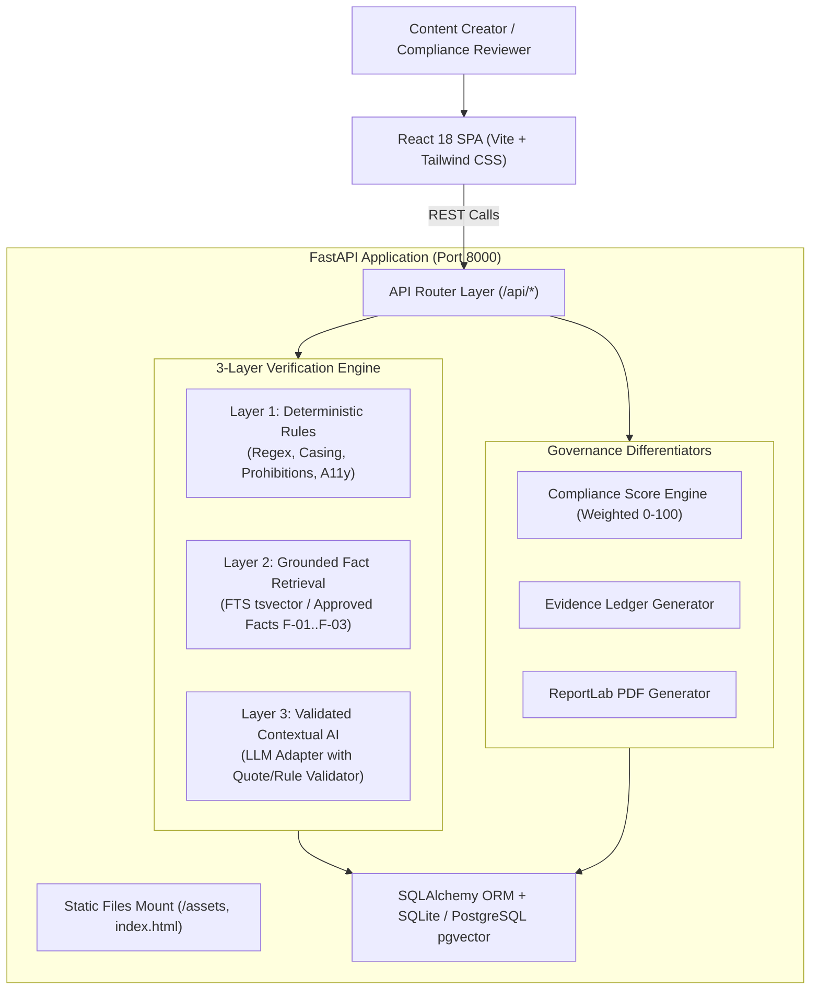
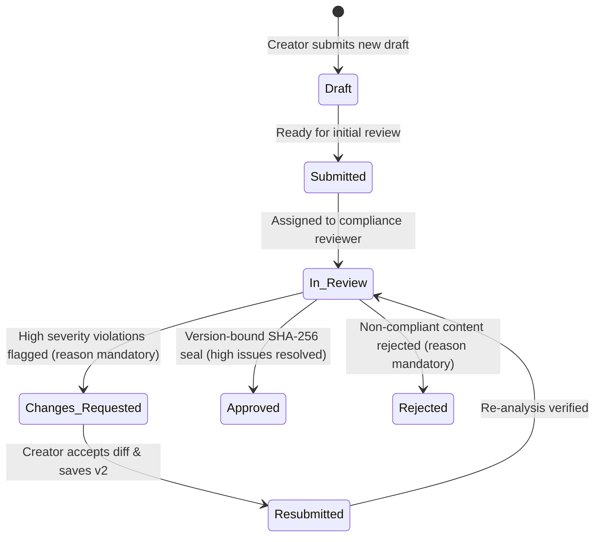

# VERITY System Architecture

**Product:** VERITY — Intelligent Brand Governance Platform  
**Team:** COGNEXA • WCC Forge 48 (Inkloom AI Problem Statement)

---

## 1. High-Level System Architecture

---

## 2. Review & Approval State Machine

---

## 3. Data Isolation Model

- **Multi-Tenant / Guest Isolation:** Every visitor is allocated an isolated workspace UUID stored in a session cookie.
- **Strict Query Scoping:** All database queries for brand guidelines, rules, approved facts, submissions, and audit events are strictly parameterized by `workspace_id`.
- **Zero Cross-Contamination:** Evaluators and judges run independent evaluations without overwriting shared brand data.

---

## 4. Round 3 Architectural Safeguards

- **Durable Storage & Alembic Migrations:** PostgreSQL persistence with automated migration versioning (`/api/ready` readiness probe) and relational binary blob storage.
- **Claim Evidence Ledger:** Dedicated extraction and grounding engine mapping every draft claim to verified institutional facts. Unbacked claims block review sign-off without recorded audit override.
- **Concurrency & Stale Version Rejection:** Review decisions require an explicit `version_id`. If a newer version exists, the server raises HTTP 409 to prevent accidental approvals of stale drafts.
- **Audit Export Pipeline:** Streaming CSV export endpoints (`/api/submissions/{id}/audit.csv` and `/api/audit/export.csv`) for compliance verification.

