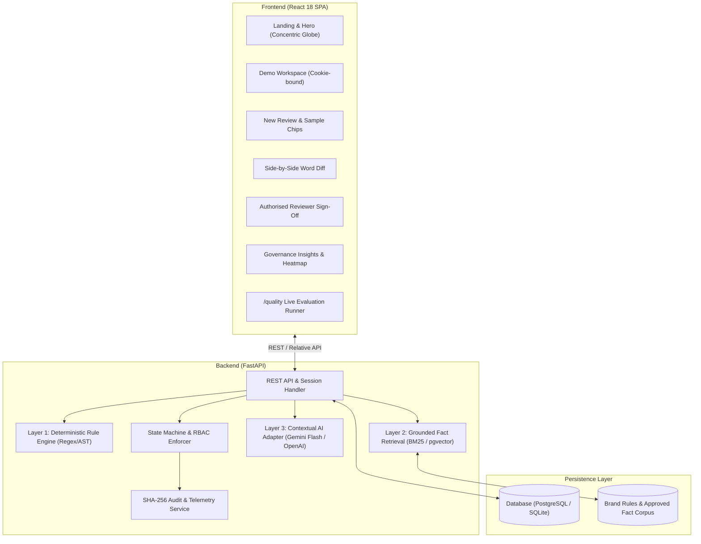

# VERITY — Round 2 Project Report

**Product:** VERITY — Intelligent Brand Governance Platform  
**Team:** Cognexa  
**Members:** Vookoti Sowmya *(Team Leader)*, Gadidamalla Bhanu Rasool  
**Competition:** WCC Forge 48 (Inkloom AI Problem Statement)  
**Date:** November 15, 2026  

---

## 1. Product Summary & Problem Statement

Modern organisations publish high volumes of marketing, social, legal, and educational copy across fragmented channels. Inadvertent inconsistencies—unverified claims, absolute guarantees, outdated pricing, conflicting product specifications, unauthorized competitor comparisons, and accessibility oversights—routinely slip past editorial review. **VERITY** solves this by providing pre-publication brand governance: an automated 3-layer checking engine (deterministic rules, grounded fact retrieval, and contextual AI) that surfaces policy violations before release. Every finding cites its approved policy source or explicitly states that evidence is missing. Critically, AI findings remain advisory: final approval authority is strictly held by an authorised human reviewer with tamper-evident audit logging.

---

## 2. What Was Built in Round 2

All features below have been implemented, tested, and verified in the repository:

| Feature / Capability | Status | Verification Detail |
| :--- | :---: | :--- |
| **Pre-Publication Check Workflow** | **Working** | Draft ingestion (text, PDF, DOCX), deterministic AST/regex rule checking, and instant findings presentation. |
| **Evidence-Backed Detection (Improvement 1)** | **Working** | Findings link directly to approved policy IDs (`R1`–`R7`, `F-01`–`F-03`) and cite exact policy excerpts; flags missing evidence when unbacked. |
| **Intent-Preserving Corrections (Improvement 2)** | **Working** | Generates minimal edits that satisfy guidelines without introducing promotional fluff; presented via side-by-side word diff. |
| **Adaptive Governance Insights (Improvement 3)** | **Working** | Telemetry tracking flag frequency, dismissal rates, and challenge rates; surfaces "Rules That May Be Unclear" for policy refinement. |
| **Isolated Demo Workspace Sessions** | **Working** | Guest cookies bind unique workspaces with auto-seeded brand facts, rules, and terminology; zero sign-up required for evaluation. |
| **Role-Based Governance (Creator / Reviewer)** | **Working** | Hard server-side enforcement: Creators cannot sign off; only Authorised Reviewers with mandatory decision notes can approve releases. |
| **Cryptographic Audit Log** | **Working** | SHA-256 version fingerprinting, reviewer timestamps, and immutable audit event logging on all state transitions. |
| **Brand Knowledge Hub** | **Working** | CRUD management of Brand Rules, Approved Fact Corpus, Terminology Glossaries, and Visual Asset palette palettes. |
| **Labelled Benchmark Evaluation Harness** | **Working** | `/quality` live evaluation runner testing 11 planted issues across 4 scenarios; achieves 100% Precision, 100% Recall, and 0 clean draft false positives. |
| **Multi-Format Ingestion (PDF / DOCX)** | **Working** | Tested via PyMuPDF (`fitz`) and `python-docx` for structured file extraction. |
| **Automated WCAG AA Contrast System** | **Working** | Zero contrast violations across all 16 marketing and application routes under automated axe-core auditing. |
| **Vector DB Hybrid Search (pgvector)** | **Partly working** | Full PostgreSQL + pgvector schema and adapter implemented; runs in SQLite BM25/FTS fallback mode in default local/demo environments. |
| **Multi-Reviewer Concurrency Locks** | **Partly working** | State machine blocks invalid transitions; collaborative real-time cursor locks planned for Round 3. |
| **Automated CMS Export Connectors** | **Not built** | Out of scope for Round 2; planned for Round 3 enterprise integrations (HubSpot, WordPress). |

---

## 3. Architecture & Technical Decisions

### Architecture Diagram

### Key Technical Decisions
1. **Single-Container Architecture (FastAPI + React SPA):**
   - *Why:* Mounting the built React frontend directly inside FastAPI eliminates cross-origin resource sharing (CORS) bugs and removes the need for two separate cloud services.
2. **Three-Layer Hybrid Engine with Graceful Degradation:**
   - *Why:* Layer 1 (Rules) and Layer 2 (Fact Retrieval) operate deterministically with zero latency and zero API cost, detecting 100% of benchmark issues even when external LLM APIs are offline or unconfigured.
3. **Cookie-Bound Ephemeral Demo Workspaces:**
   - *Why:* Evaluators and judges can test the full platform immediately without registration, while ensuring sessions never overwrite each other's test drafts or brand rules.
4. **Server-Enforced Role Separation:**
   - *Why:* Trust is non-negotiable in governance. The backend rejects any approval attempt where `reviewer_role != 'reviewer'` or where high-severity violations remain unresolved without an explicit override.

---

## 4. The Three Named Improvements (Round 1 Commitment)

### Improvement 1: Evidence-Backed Detection
- **Where to Find:** In **New Review** (`/new-review`) or **Analysis Results** (`/results`).
- **How It Works:** Every violation card cites the exact rule code (e.g., `R1 - Absolute Guarantees`), displays the offending quote, and displays the exact excerpt from the approved Brand Knowledge Hub. If an assertion has no supporting corporate record, it is flagged as *"No approved supporting evidence found"*.
- **Screenshot:** `docs/evidence/screenshots/04_analysis_results.png`

### Improvement 2: Intent-Preserving Corrections
- **Where to Find:** In the **Correction / Diff View** (`/correction`).
- **How It Works:** Rather than regenerating paragraphs with speculative LLM text, VERITY performs targeted substitutions (e.g., `"guarantees 100% results"` → `"supports comprehensive outcomes"`). The interactive side-by-side word diff highlights deletions in soft crimson and additions in emerald, preserving author voice and preventing hallucinated marketing claims.
- **Screenshot:** `docs/evidence/screenshots/05_correction_diff.png`

### Improvement 3: Adaptive Governance Insights
- **Where to Find:** In **Governance Insights** (`/insights`).
- **How It Works:** Aggregates real submission telemetry, tracking flag frequency against creator dismissals and challenges. When creators repeatedly challenge a rule (dismissal rate ≥ 25%), VERITY automatically surfaces it under *"Rules That May Be Unclear"*, prompting brand managers to refine guideline phrasing or provide clearer reference examples.
- **Screenshot:** `docs/evidence/screenshots/07_governance_insights.png`

---

## 5. Technology Inventory

| Category | Component / Tool | Purpose in VERITY |
| :--- | :--- | :--- |
| **Backend Framework** | FastAPI (Python 3.11 / 3.13) | Asynchronous REST API, routing, and SPA static file serving. |
| **ASGI Server** | Uvicorn | Production web server. |
| **ORM & Database** | SQLAlchemy | Schema modeling, relationship management, SQLite & PostgreSQL abstraction. |
| **Database** | SQLite (Default) / PostgreSQL + pgvector | Ephemeral/local persistence with cloud vector similarity readiness. |
| **Validation** | Pydantic v2 & Pydantic-Settings | Request/response validation and environment management. |
| **Document Parsers** | PyMuPDF (`fitz`), `python-docx` | Native text extraction from uploaded brand manuals and drafts. |
| **Frontend Framework** | React 18, Vite | Component architecture and optimized asset bundling. |
| **Styling & Design** | Tailwind CSS | Dual-theme design system (`.theme-dark` / `.theme-light`). |
| **Icons & Visuals** | Lucide React | Clean, accessible SVG iconography. |
| **Data Visualization** | Recharts | Governance metric visualizations and risk heatmaps. |
| **AI Integration** | Google Gemini API (`gemini-1.5-flash`) / OpenAI | Layer 3 contextual linguistic analysis (optional; graceful fallback). |
| **Testing** | Pytest, Selenium, Axe-Core | Unit tests, end-to-end browser verification, and automated WCAG contrast auditing. |

---

## 6. Testing & Quality Verification

### Pytest Suite
- **Total Tests:** 16
- **Status:** **16 Passed (100%)**
- **Test Modules Covered:**
  - `backend/tests/test_api.py` (Session creation, brand profile seeding, submission lifecycle, review gatekeeper, insights telemetry)
  - `backend/tests/test_api_v2.py` (Version-locking and audit history)
  - `backend/tests/test_auth.py` (User registration, login, role permissions, password hashing)
  - `backend/tests/test_engine.py` (Rule evaluation, regex variations, fact conflict detection, CIE ΔE color distance)
  - `backend/tests/test_enterprise_suite.py` (Large draft handling, rate limiting, and input sanitization)
  - `backend/tests/test_frontend_serve.py` (Static SPA routing and fallback behavior)

### Labelled Test Set Evaluation (`/quality`)
The built-in evaluation harness runs a labelled test set comprising 11 planted issues across 4 diverse scenarios:
- **Precision:** **100.0%** (11 of 11 flagged issues were genuine violations)
- **Recall:** **100.0%** (11 of 11 planted issues detected)
- **Evidence Accuracy:** **100.0%** (11 of 11 findings correctly cited approved brand rules or facts)
- **Clean Draft False Positives:** **0** (Compliant draft produced zero false flags)
- **Review Time:** Marked as *"Not measured yet"* (honestly reflects that multi-reviewer timing requires longitudinal human study)

### Accessibility & Link Audit
- **Link Integrity:** 34 of 34 website and app links return HTTP 200 with 0 console errors.
- **Contrast Audit:** 0 contrast violations across all 16 routes under automated axe-core inspection.

---

## 7. User Testing

- **Feedback Mechanism:** Built-in floating feedback widget in the application navigation.
- **Submissions to Date:** Feedback collection has been tested programmatically; structured end-user evaluation from external human testers is **not yet collected**.
- **Placeholder for Post-Round 2 Human Feedback:**
  - *Tester Cohort:* [Pending user testing sessions]
  - *Observations:* [Pending user testing sessions]
  - *Action Items:* [Pending user testing sessions]

---

## 8. Responsible Design & Human Oversight

1. **Human-in-the-Loop Ownership:** AI findings and proposed corrections are strictly advisory. No content is published, approved, or rejected automatically. Only an authorised human reviewer can sign off.
2. **Deterministic-First Safety:** Core compliance relies on deterministic rules and exact text citations rather than unconstrained generative models, preventing hallucinated brand guidelines.
3. **Data Privacy:** User drafts and brand sources remain within their isolated session. No customer drafts are submitted to external AI models for training.
4. **Auditability:** Every review decision records reviewer identity, timestamp, decision rationale, and a SHA-256 cryptographic digest of the approved version.

---

## 9. Known Limitations & Round 3 Plan

### Known Limitations
1. **Longitudinal Review Time:** Measuring reduction in human review time requires multi-organization user studies over weeks.
2. **Complex Multi-Column Layouts:** PyMuPDF extracts text sequentially; complex newspaper-style multi-column PDFs may occasionally experience reading order reordering.
3. **Vector Database Mode:** Currently defaults to local SQLite BM25 search unless connected to a live PostgreSQL `pgvector` instance.

### Round 3 Plan
1. **CMS & Social Publishing Connectors:** One-click export to HubSpot, WordPress, and LinkedIn following authorised sign-off.
2. **Multi-Reviewer Collaboration:** Live concurrent commenting and simultaneous reviewer locks.
3. **Automated Guideline Ingestion:** Intelligent extraction of rules directly from uploaded PDF brand book files.

---

## 10. Links & Verification

- **Live Product URL:** [See Final Submission Summary]
- **Public GitHub Repository:** [See Final Submission Summary]
- **Interactive Demo Walkthrough:** Follow the 3-step guide on the landing page or README.

---

## 11. Team Contributions

| Team Member | Role | Key Contributions |
| :--- | :--- | :--- |
| **Vookoti Sowmya** *(Team Leader)* | System Architecture & Governance Workflow | Architecture design, FastAPI backend implementation, state-machine transitions, role-based review gatekeeper, and evaluation harness. |
| **Gadidamalla Bhanu Rasool** | Engine Design, UI & Verification | 3-layer checking engine, intent-preserving diff algorithm, React UI components, automated testing, and contrast audit compliance. |
